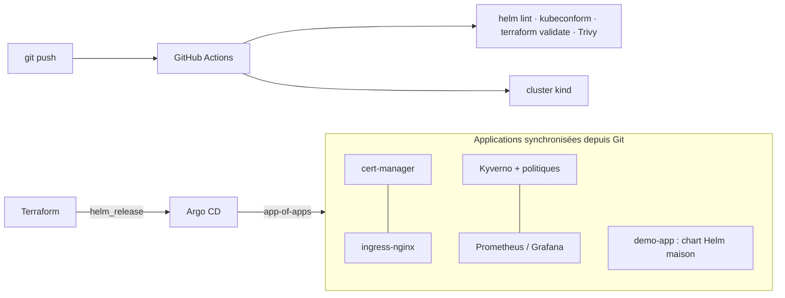

# Plateforme Kubernetes GitOps

Plateforme Kubernetes « prête pour la production », entièrement décrite dans Git et déployée automatiquement :
**Terraform** amorce **Argo CD**, qui installe ensuite toute la plateforme selon le modèle *app-of-apps*. Chaque push est validé par une **CI GitHub Actions** qui lance un vrai cluster et teste le résultat de bout en bout.

## Architecture



| Brique | Rôle |
|---|---|
| Terraform (provider Helm) | Bootstrap d'Argo CD et de l'application racine |
| Argo CD | GitOps : synchronisation automatique, self-heal, prune, sync waves |
| ingress-nginx + cert-manager | Exposition HTTPS avec certificat émis automatiquement |
| kube-prometheus-stack | Métriques (Prometheus), tableaux de bord (Grafana), ServiceMonitor |
| Kyverno | Politiques d'admission : pas de tag `:latest`, requests/limits obligatoires, non-root |
| Chart `demo-app` | Microservice durci : non-root, FS en lecture seule, capabilities supprimées, seccomp, HPA, PDB, NetworkPolicy |
| Trivy, kubeconform | Scan de sécurité IaC et validation des manifests en CI |

## Pipeline CI

1. **Lint & sécurité** : `helm lint`, `kubeconform`, `terraform fmt/validate`, scan **Trivy** (échec si vulnérabilité HIGH/CRITICAL).
2. **E2E** : création d'un cluster **kind**, `terraform apply`, puis `tests/e2e.sh` vérifie que :
   - les 8 applications Argo CD sont *Synced / Healthy* ;
   - l'application répond en **HTTPS** via l'ingress, avec un certificat cert-manager ;
   - **Prometheus** scrape bien l'application ;
   - **Kyverno** refuse un pod utilisant une image `:latest`.

## Lancer en local

```bash
kind create cluster --name gitops
cd terraform && terraform init && terraform apply
kubectl -n argocd get applications          # suivi de la synchronisation
bash ../tests/e2e.sh
```

Interface Argo CD : `kubectl -n argocd port-forward svc/argocd-server 8080:80`
(mot de passe : `kubectl -n argocd get secret argocd-initial-admin-secret -o jsonpath='{.data.password}' | base64 -d`).

## Pistes d'évolution

Secrets externalisés (HashiCorp Vault + External Secrets), logs centralisés (Loki), déploiement progressif (Argo Rollouts), cluster managé (EKS via Terraform).
